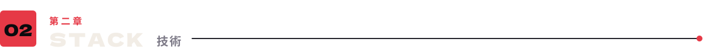
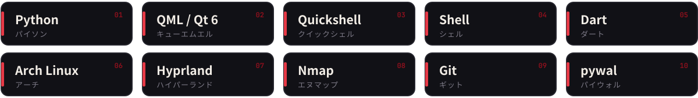
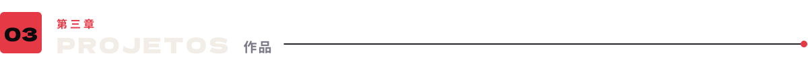
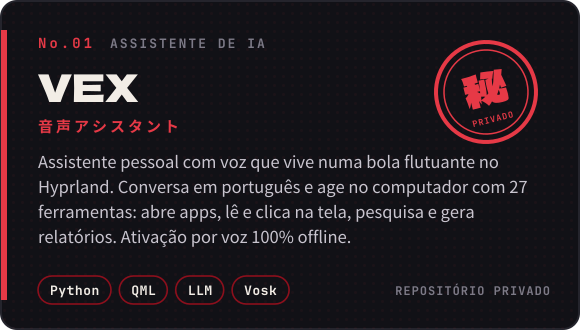
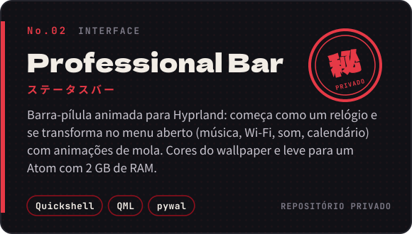
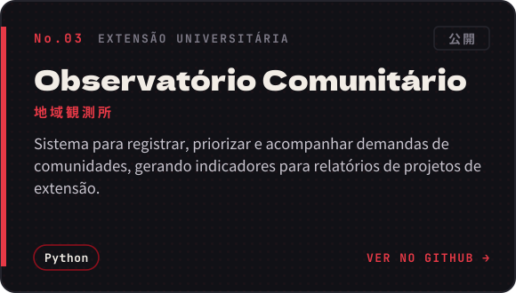
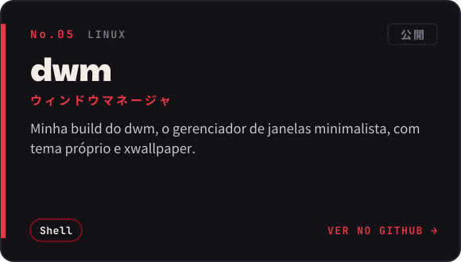
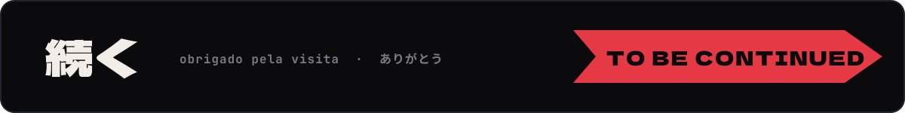

<!-- Author: Yora · arte do perfil gerada em assets/ -->

<table>
  <tr>
    <td width="58%" valign="top">

Estudante de tecnologia focado em **Linux, automação e interfaces**. Meu ambiente é **Arch Linux + Hyprland**, e a maior parte do que construo nasce dele: barras, widgets e ferramentas que deixam o desktop mais rápido e mais bonito.

- **Interfaces** em Quickshell (QML / Qt 6), leves o bastante para hardware modesto
- **Assistentes e automações** em Python com modelos de linguagem
- **Cibersegurança:** reconhecimento, auditoria de rede e red team
- **Visual** com cuidado: animação, tipografia e cores consistentes

    </td>
    <td width="42%" align="center" valign="middle">
      
    </td>
  </tr>
</table>

  
  

  
  

  
  

